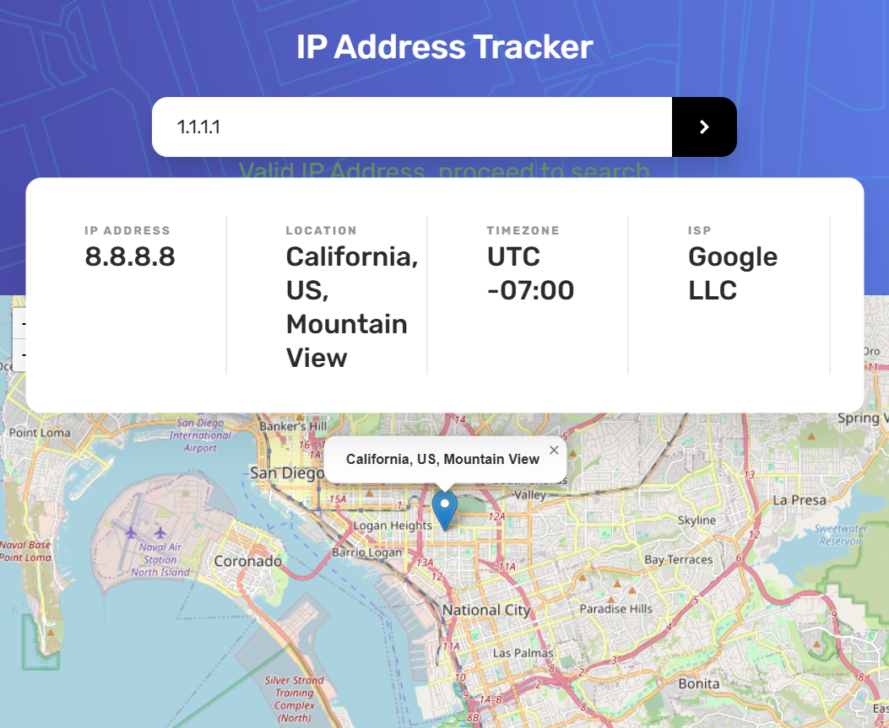
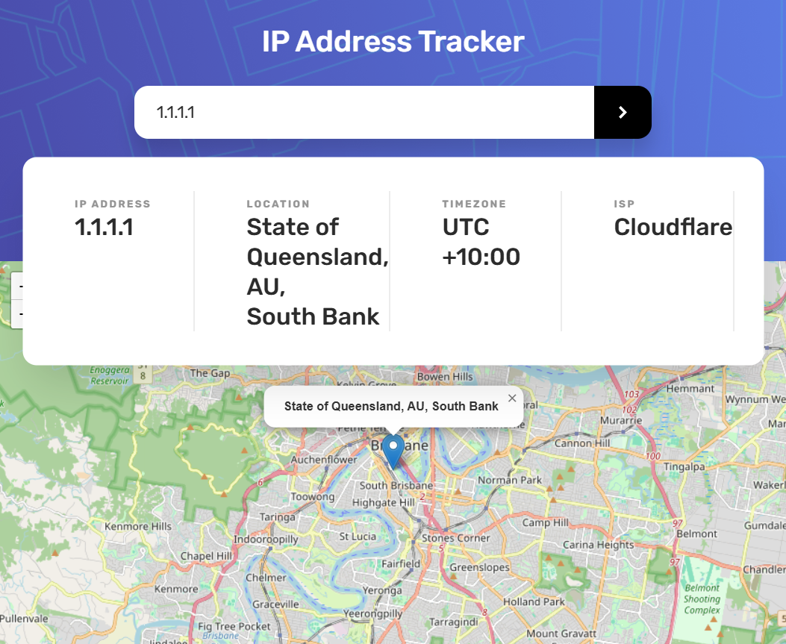
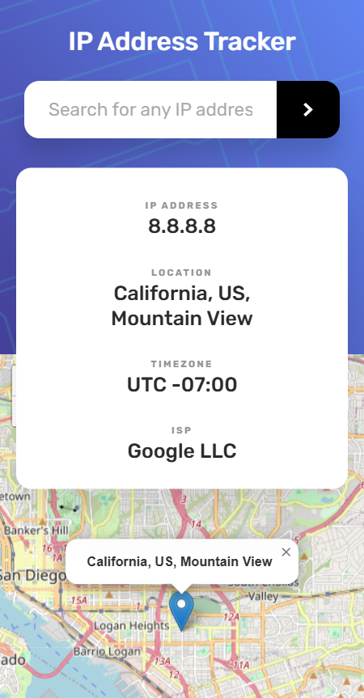

# IP Address Tracker

A one-page tracker. The heading is "IP Address Tracker".

## Description

The typeface is Rubik. The page loads `dist/index.js`, which is the compiled copy of `src/index.ts`, and it loads Leaflet from the unpkg script in `index.html`.

Serve this folder and open `index.html`. The script is a module, so it needs a local server. This run used http://127.0.0.1:5522/.

The lookup goes to `https://geo.ipify.org/api/v2/country,city`. The key is written in `src/services/apiService.ts`. The map is a Leaflet map at zoom 12 with OpenStreetMap tiles and one marker. The marker popup opens on its own.

The first lookup is the address `8.8.8.8`. The card starts as "IP Address Loading ...", "Location Loading ...", "Timezone Loading ...", and "ISP Loading ...", then fills in.

This response was IP `8.8.8.8`, location California, US, and Mountain View, timezone `UTC -07:00`, and ISP Google LLC. The postal code was empty. The coordinates were latitude `32.69922` and longitude `-117.11281`, so the pin sits in the San Diego area while the city name is Mountain View. The popup reads "California, US, Mountain View".

The line under the heading is "Look up an IP address, a domain, or an email." The labels are uppercase. The result card is four columns, two columns from 900px, and one centered column from 640px. `UTC -07:00` and `Google LLC` each stay on one line.

The box placeholder is "Search for any IP address, domain or email". Typing checks the text as an IP address, then an email, then a domain.

`hello` shows the red sentence "Please enter a valid IP address, Email, or Domain."

`1.1.1.1` shows "Valid IP Address, proceed to search" in `rgb(217, 255, 230)`. That line sits on the header, above the white card.

The search button and the Enter key both run the lookup and clear that message. Searching `1.1.1.1` returned State of Queensland, AU, and South Bank, timezone `UTC +10:00`, ISP Cloudflare. The postal code was empty. The pin is at latitude `-27.47766` and longitude `153.0211`.

`google.com` shows "Valid Domain Name, proceed to search". The lookup returned IP `142.251.215.206`, location California, US, and The Greenhouse, timezone `UTC -07:00`, ISP Google LLC, at latitude `37.41889` and longitude `-122.10361`.

`ada@example.com` shows "Valid Email Address, proceed to search". The lookup returned 200 and the body `{"results":[]}`. That body has no location, so the card stayed on the Google result and the message was cleared.

A value that fails the three checks does not change the last query type. After the email search, `hello` was still sent as an email. That request returned 422 and `{"code":422,"messages":"Input correct email."}`. The red sentence was cleared by the click, and the card stayed on `142.251.215.206`.

The search button is `hsl(230, 28%, 14%)` and turns `hsl(230, 35%, 28%)` on hover and keyboard focus. The pin is `images/icon-location.svg`.

From 640px down, the header uses `images/pattern-bg-mobile.png`. The card becomes one centered column, and the dividers between the columns go away. The placeholder fits in the search box.

## Screenshots

These pictures are from the earlier layout, before the header, card, and pin were restyled.

### First load

### Search

### Narrow window

## Getting Started

### Dependencies

* A local static server, because the script is a module
* A network connection for the ipify lookup, Leaflet, and the map tiles
* The key already written in `src/services/apiService.ts`

### Installing

No install step. The page loads `dist/index.js`.

### Executing program

Serve this folder and open `index.html`. This run used http://127.0.0.1:5522/.

## Help

* `hello` shows "Please enter a valid IP address, Email, or Domain."
* After an email search, a later invalid value is still sent as an email. `hello` then returned 422 and `{"code":422,"messages":"Input correct email."}`.
* `ada@example.com` returned 200 and `{"results":[]}`. The card stayed on the previous result.
* The valid message sits on the header, above the white card.
* The pin for `8.8.8.8` is near San Diego while the city name is Mountain View.

## Authors

[Mamadou Moussa Balde](https://www.linkedin.com/in/2mb/)

## Version History

* Current local run
    * Served at http://127.0.0.1:5522/
    * First lookup `8.8.8.8`, then `1.1.1.1`, `google.com`, and `ada@example.com`

## License

This folder does not include a `LICENSE.md` file.

## Acknowledgments

* [Leaflet](https://leafletjs.com/)
* [OpenStreetMap](https://www.openstreetmap.org/)
* [IPify](https://geo.ipify.org/)
* [README template](https://gist.github.com/DomPizzie/7a5ff55ffa9081f2de27c315f5018afc)
